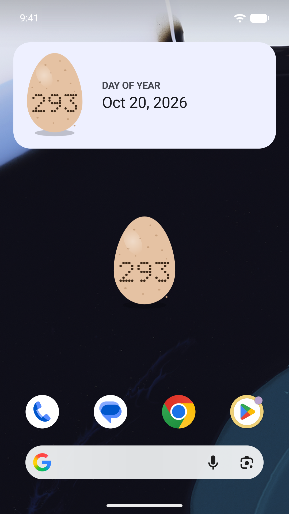
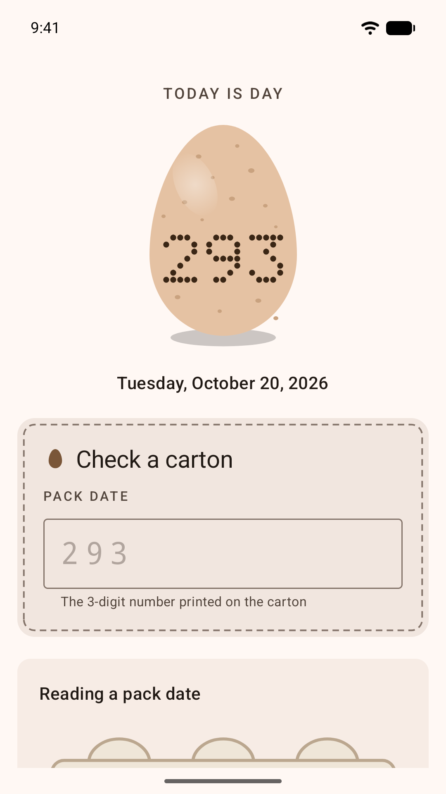
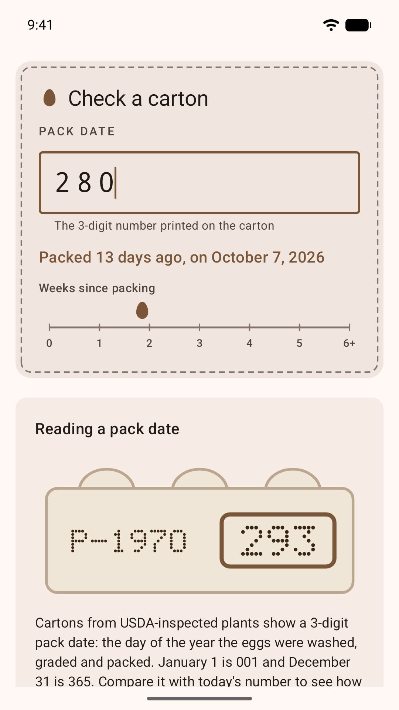
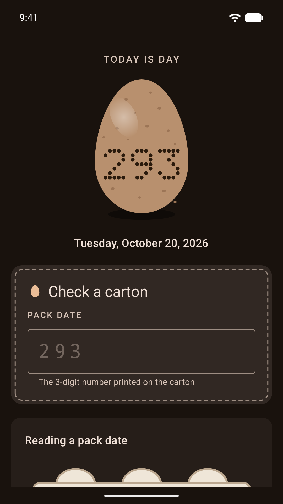

# Egg Day Widget

A home screen widget that shows today's day of the year (001–366), so you can compare it with the 3-digit pack date printed on egg cartons.

[Get it on Google Play](https://play.google.com/store/apps/details?id=com.etiennelawlor.eggday)

<p>
  
  
  
  
</p>

## Features

- **Widget**: a brown egg stamped with today's day number in dotted, carton-style inkjet digits. At its smallest it's just the egg on your wallpaper; wider, it adds "DAY OF YEAR" and the date. It updates at midnight and whenever the clock or time zone changes.
- **Carton checker**: type the pack date from a carton to see how many days ago the eggs were packed, with an egg marker on a 0–6 week scale. Dates later than today are treated as last year.
- **Add to home screen**: pin the widget straight from the app.

## Pack dates

Cartons from USDA-inspected plants show a pack date as a Julian day: January 1 is 001 and December 31 is 365 (366 in leap years). It's the day the eggs were washed, graded and packed.

## Building

Requirements: JDK 21 and the Android SDK with platform 37.

```sh
./gradlew test            # unit tests
./gradlew assembleDebug   # debug APK
```

### Release signing

Release builds read signing details from `signing.properties` in the project root. That file and all keystores are gitignored.

```properties
keyStore=/absolute/path/to/eggday.keystore
keyStorePassword=...
keyAlias=eggday-release
keyAliasPassword=...
```

```sh
./gradlew bundleRelease   # app/build/outputs/bundle/release/app-release.aab
```

Without `signing.properties`, release builds are produced unsigned.

## Art

The egg, dot-matrix digits, carton illustration and launcher icon are vector drawables generated by `scripts/generate_art.py` from one set of shapes. Edit the script and re-run it rather than editing the drawables:

```sh
python3 scripts/generate_art.py
```

It also writes `art/play-icon.svg`; `art/play-icon-512.png` is that SVG rasterized for the Play Store listing.

Play Store phone screenshots are in `art/screenshots/phone/`: 1080 × 1920 PNGs captured on an Android 17 emulator.

## Tech

Kotlin, Jetpack Compose with Material 3, and Jetpack Glance for the widget. compileSdk and targetSdk 37, minSdk 26.
